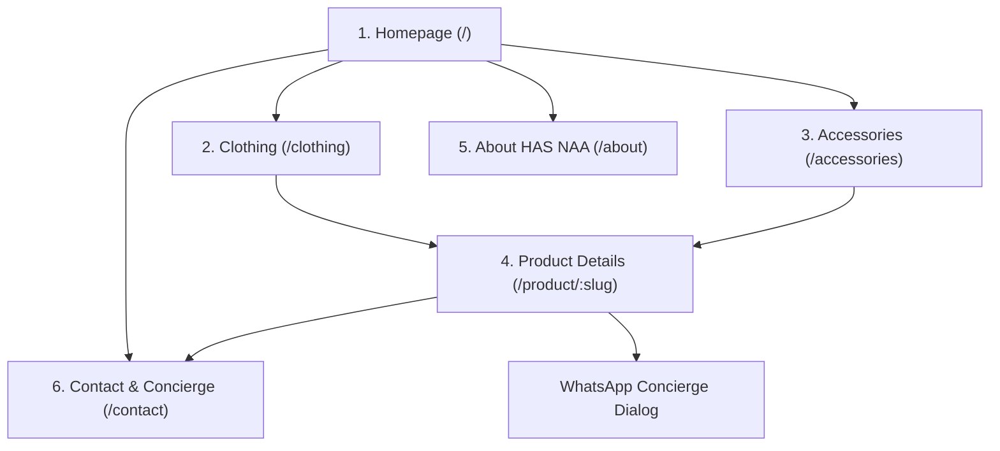
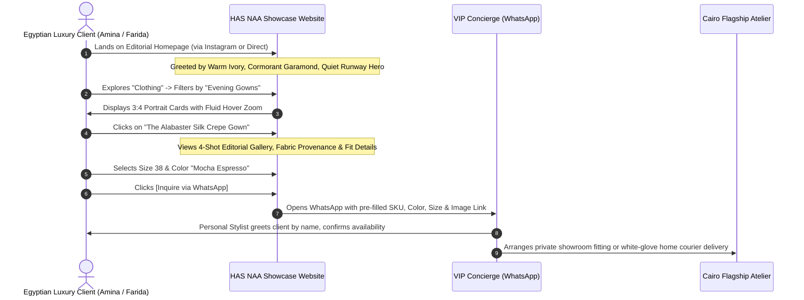

# HAS NAA — Website Sitemap & User Journey Architecture
**Project:** Luxury Fashion Brand Showcase Website  
**Philosophy:** Quiet Luxury &middot; Editorial Exhibition &middot; Concierge Client Relationship  
**Market:** Modern Egyptian & Arab Women (Ages 18–45)  
**Languages:** Bilingual (English LTR / Arabic RTL)  
**Version:** 1.0 (Architecture Proposal)

---

## 1. Digital Strategy & Architectural Philosophy

### 1.1 Showcase vs. Transactional E-commerce
Unlike conventional commercial e-commerce platforms focused on conversion funnels, flash sales, discount counters, and cart checkouts, **HAS NAA** is conceptualized as an **online haute-couture gallery and digital salon**. 

```
┌────────────────────────────────────────────────────────────────────────┐
│                   COMMERCIAL ECOMMERCE vs. HAS NAA SHOWCASE            │
├──────────────────────────────────┬─────────────────────────────────────┤
│ Conventional E-commerce          │ HAS NAA Luxury Showcase             │
├──────────────────────────────────┼─────────────────────────────────────┤
│ Aggressive "Add to Cart" popups  │ Poised "Inquire via Concierge"      │
│ Discount tickers & coupon codes  │ Editorial storytelling & provenance │
│ Complex checkout & shipping fees │ Direct WhatsApp & private fittings  │
│ Dense, cluttered product grids   │ Generous whitespace & portrait art  │
│ Impersonal automated transaction │ High-touch personal client advisory │
└──────────────────────────────────┴─────────────────────────────────────┘
```

The objective is to evoke desire, establish cultural prestige, present the craftsmanship of Egyptian cotton and fine silk, and guide the client effortlessly toward **private showroom appointments, bespoke styling consultations, and direct WhatsApp concierge inquiries**.

---

## 2. Master Website Sitemap & Navigation Tree

The sitemap is deliberately streamlined into six primary pages to maintain serenity and effortless navigation:



### 2.1 Navigation Architecture Breakdown

```
HAS NAA (Master Navigation Structure)
│
├── 1. TOP ANNOUNCEMENT BAR (Global Minimalist Ticker)
│   ├── EN: "Worldwide Online Inquiries & Complimentary Courier Delivery Across Egypt"
│   └── AR: "استفسارات وتوصيل سريع لكافة أنحاء مصر وحول العالم"
│
├── 2. PRIMARY HEADER (Sticky Editorial Navigation)
│   ├── Left (LTR) / Right (RTL): [CLOTHING] [ACCESSORIES] [ABOUT]
│   ├── Center: [HAS NAA Master Wordmark + HN Monogram]
│   └── Right (LTR) / Left (RTL): [WHATSAPP CONCIERGE] [EN / عربي SWITCHER]
│
├── 3. CORE PAGES
│   ├── 1.0 HOMEPAGE (/)
│   │   ├── 1.1 Editorial Runway Hero Banner
│   │   ├── 1.2 Curated Clothing Collection Teaser
│   │   ├── 1.3 Artisanal Accessories Showcase
│   │   ├── 1.4 New Arrivals (Curated 4-Column Showcase)
│   │   ├── 1.5 Heritage & Atelier Feature (Split Image-Text Story)
│   │   ├── 1.6 Private Client Services & Concierge Banner
│   │   ├── 1.7 Instagram / Editorial Visual Gallery
│   │   └── 1.8 Master Footer
│   │
│   ├── 2.0 CLOTHING SHOWCASE (/clothing)
│   │   ├── 2.1 Editorial Category Header & Philosophy Quote
│   │   ├── 2.2 Subcategory Filter Tabs (All, Ready-to-Wear, Evening Gowns, Modest Luxury, Resort & Linen)
│   │   ├── 2.3 Sort & View Density Controller (2-Col Editorial vs 4-Col Grid)
│   │   ├── 2.4 Product Showcase Grid
│   │   └── 2.5 Bespoke Tailoring Consultation Banner
│   │
│   ├── 3.0 ACCESSORIES SHOWCASE (/accessories)
│   │   ├── 3.1 Editorial Category Header
│   │   ├── 3.2 Subcategory Filter Tabs (All, Leather Handbags, Silk Scarves, Belts, Fine Accents)
│   │   ├── 3.3 Sort & View Controller
│   │   ├── 3.4 Accessories Showcase Grid
│   │   └── 3.5 Material & Provenance Highlight
│   │
│   ├── 4.0 PRODUCT DETAILS (/product/:slug)
│   │   ├── 4.1 Dual-Column Asymmetric Layout (Left: 4-Shot Gallery / Right: Sticky Info)
│   │   ├── 4.2 Product Title, Category Kicker & Reference Code
│   │   ├── 4.3 Price in EGP (ج.م) & Fabric Composition Badge
│   │   ├── 4.4 Color Swatch Selector (Tactile Silk/Leather Samples)
│   │   ├── 4.5 Size Selector (FR / IT / Egypt Sizing) + Interactive Size Guide Modal
│   │   ├── 4.6 Primary Action: "Inquire via WhatsApp" (Direct pre-filled message)
│   │   ├── 4.7 Secondary Action: "Book Private Boutique Fitting"
│   │   ├── 4.8 Accordion Details: Fabric & Care, Craftsmanship, Complimentary Tailoring
│   │   └── 4.9 Complete the Look / Recommended Pairings
│   │
│   ├── 5.0 ABOUT HAS NAA (/about)
│   │   ├── 5.1 Hero: The Philosophy of HAS NAA (حسناء)
│   │   ├── 5.2 Egyptian Heritage & Contemporary Alexandria Inspiration
│   │   ├── 5.3 The Atelier & Artisanal Craftsmanship
│   │   ├── 5.4 Fabric Integrity (Pure Egyptian Cotton, Mulberry Silk, Linen)
│   │   └── 5.5 Sustainable Quiet Luxury Commitment
│   │
│   └── 6.0 CONTACT & ONLINE CONCIERGE (/contact)
│       ├── 6.1 Direct VIP WhatsApp Styling Consultation
│       ├── 6.2 Online Message & Inquiry Form
│       ├── 6.3 Client Services Hours & Response Time
│       ├── 6.4 Official Email & Social Channels
│       └── 6.5 Frequently Asked Client Questions (FAQ)
│
└── 4. GLOBAL FOOTER
    ├── Col 1: Brand Wordmark, Slogan & Monogram Seal
    ├── Col 2: Collections (Ready-to-Wear, Evening, Silk, Leather)
    ├── Col 3: Client Services (Online Concierge, WhatsApp Inquiry, Fabric Care)
    ├── Col 4: The House (About HAS NAA, Heritage, Sustainability)
    ├── Col 5: Newsletter ("The Private Journal" — Quiet fashion essays)
    └── Bottom Bar: Copyright 2026 HAS NAA, Privacy, Terms, Language Switcher
```

---

## 3. Egyptian Target User Personas

To ensure the digital experience resonates authentically with Egyptian women aged 18–45, three representative client personas guide all UX decisions:

### Persona 1: Amina El-Sayed (Age 33) — The Cultured Connoisseur
- **Location:** Zamalek & New Cairo.
- **Profession:** Senior Interior Architect & Contemporary Art Collector.
- **Behavior:** Seeks structured modesty, understated silhouettes, and natural breathable textiles (Egyptian linen, silk crepe) for architecture site visits, gallery vernissages, and evening dinners.
- **Pain Point:** Frustrated by loud luxury logos and synthetic fast fashion. Values discreet tailoring and high-touch bespoke service.
- **Digital Habit:** Browses on iPad and desktop during evening quiet hours; appreciates generous editorial whitespace and detailed textile descriptions.

### Persona 2: Farida Mansour (Age 23) — The Modern Editorial Muse
- **Location:** Sheikh Zayed & Alexandria.
- **Profession:** Digital Fashion Strategist & Creative Director.
- **Behavior:** Highly attuned to Milan and Paris fashion weeks; looks for statement silk foulards, artisanal leather shoulder bags, and contemporary monochromatic sets.
- **Pain Point:** Demands instant mobile responsiveness, pristine photography, and zero checkout friction.
- **Digital Habit:** 90% mobile usage via iPhone Safari and Instagram; prefers initiating purchases directly through WhatsApp with direct concierge assistance.

### Persona 3: Laila Fahmy (Age 45) — The Elite Boutique Patron
- **Location:** Heliopolis / Katameya Dunes.
- **Profession:** Philanthropist & Luxury Travel Curator.
- **Behavior:** Regularly commissions bespoke couture evening gowns and seasonal wardrobe capsules for social galas and international travel.
- **Pain Point:** Despises automated shopping carts; requires personal stylist relationships, private showroom viewings, and home garment fitting.
- **Digital Habit:** Reviews new lookbooks online, then taps "Book Atelier Appointment" or messages the head concierge directly.

---

## 4. End-to-End User Journeys



### Journey 1: The Editorial Discovery to Concierge Inquiry
1. **Entry:** Client enters homepage; encounters full-screen editorial video/photo hero depicting natural sunlight on pure raw silk.
2. **Browsing:** Scrolls to "Curated Clothing Collection" and clicks "Explore Clothing".
3. **Filtering:** Selects filter tab `Ready-to-Wear` or `Resort & Linen`. Sorts by `Curated Editorial Order`.
4. **Product Immersion:** Clicks product card. On the Product Details page, examines high-resolution zoom showing fabric weave, stitch density, and drape.
5. **Action:** Clicks the prominent Charcoal CTA: `Inquire via WhatsApp`.
6. **Conversion:** Client is greeted immediately in WhatsApp by an Egyptian luxury stylist with a pre-formatted message:  
   *“Hello HAS NAA Atelier, I am inquiring about The Alabaster Silk Crepe Gown (Ref: HN-DR-2601) in Mocha Brown, Size 38. Could you please confirm atelier availability and fitting options?”*

### Journey 2: The Atelier Appointment Booking
1. **Entry:** Client navigates to `About HAS NAA` to understand brand philosophy and Egyptian provenance.
2. **Engagement:** Reads about master Egyptian tailoring and atelier craftsmanship in Cairo and Alexandria.
3. **Intent:** Clicks `Book Private Atelier Appointment` CTA at the conclusion of the story.
4. **Form Completion:** Smoothly selects preferred date, time, showroom location (Zamalek or New Cairo Flagship), and specific collection pieces of interest.
5. **Confirmation:** Client receives an elegant instant digital confirmation card and an automated calendar invitation with direct concierge contact.

---

## 5. Architectural Quality Checklist

- [x] Strictly zero e-commerce cart, checkout, or payment gateway clutter.
- [x] Seamless bilingual navigation across all 6 pages with instant state persistence.
- [x] High-touch VIP WhatsApp concierge integration directly linked to product SKUs.
- [x] Complete alignment with the approved Quiet Luxury palette (`#F5F0E8`, `#292522`, `#DCC8AC`, `#A68B70`, `#6B5140`).
- [x] Proportional layout ratios designed around haute-couture editorial standards.
